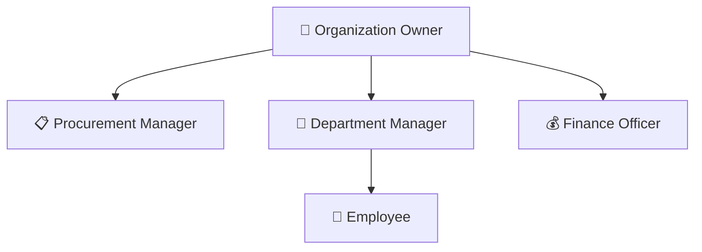
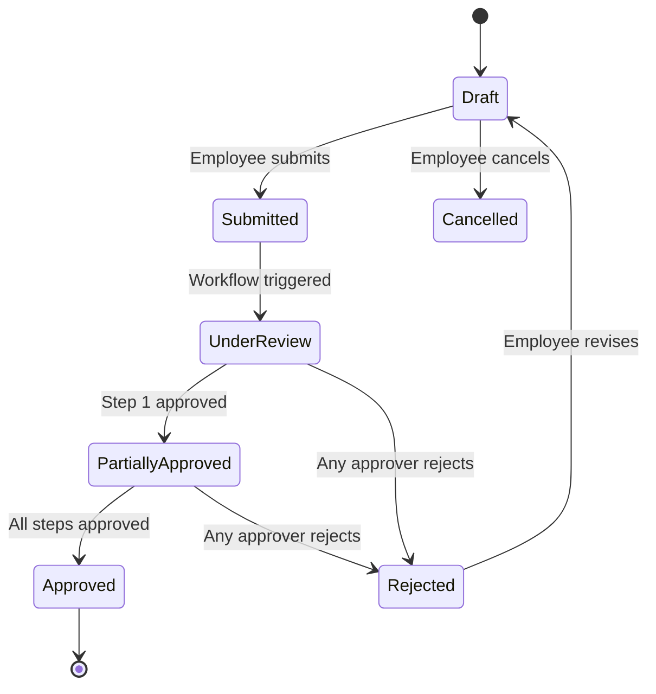
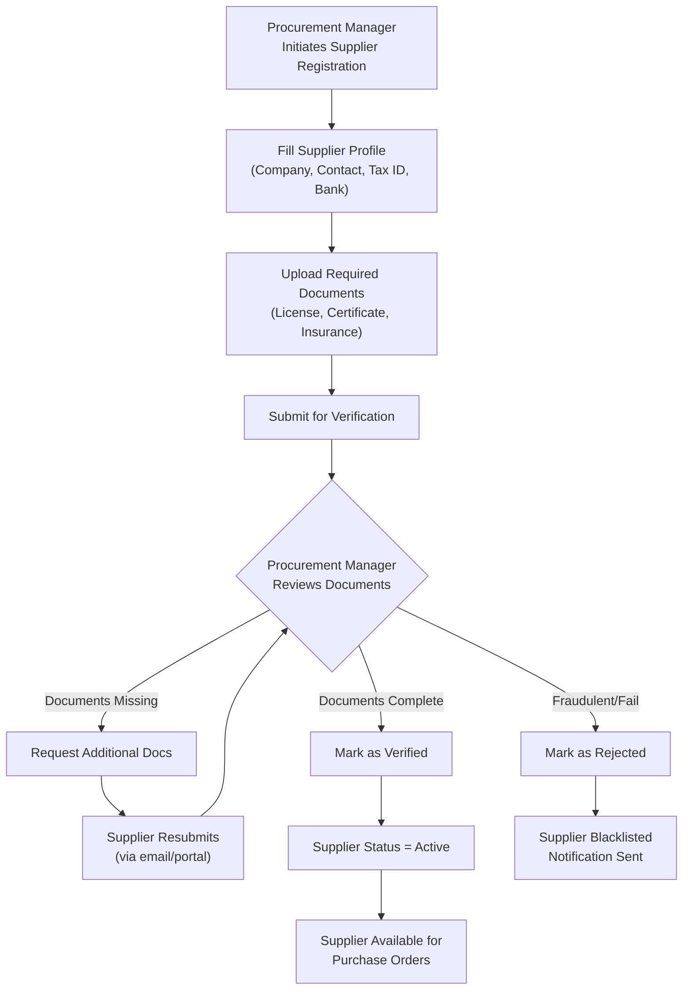
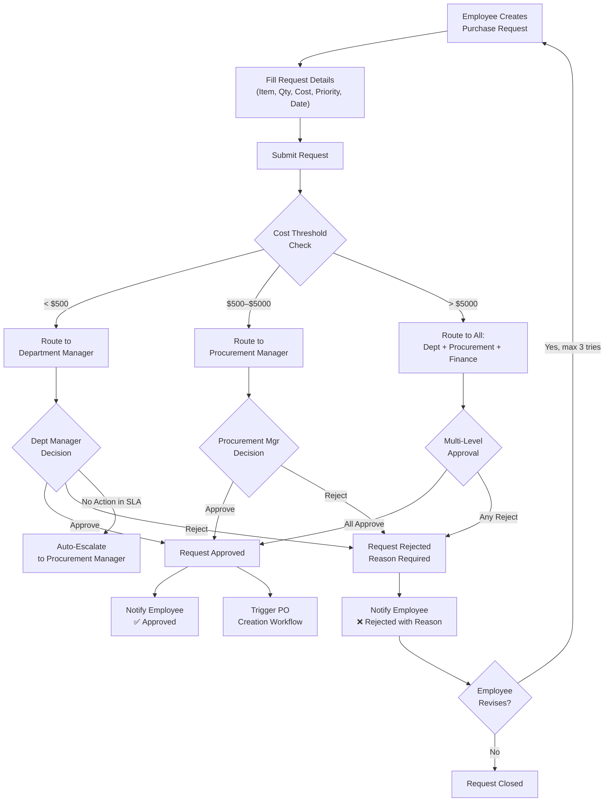
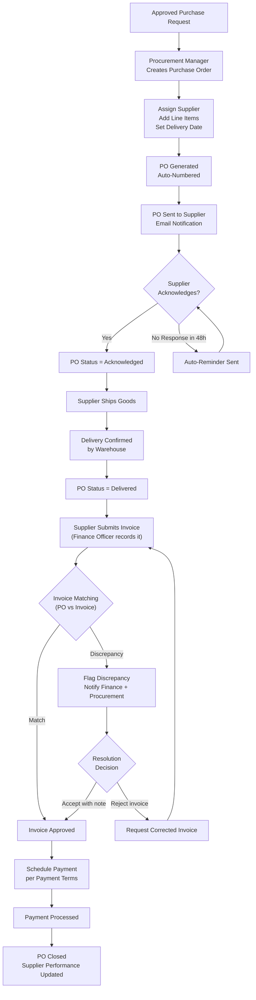

# Deliverable 01 — Product Feature Design
# SupplyMesh: Global Procurement & Supplier Intelligence Platform

---

## 1. Executive Summary

SupplyMesh is an enterprise-grade, multi-tenant SaaS platform that centralizes the entire procurement lifecycle — from supplier onboarding to payment processing — for medium-to-large organizations operating across multiple departments, business units, and geographies.

The platform replaces fragmented spreadsheets, email-based approvals, and siloed ERP modules with a unified, role-aware, workflow-driven system.

---

## 2. User Roles & Capabilities

### Role Hierarchy



### Role-Capability Matrix

| Capability | Org Owner | Procurement Mgr | Dept Mgr | Finance Officer | Employee |
|-----------|:---------:|:---------------:|:--------:|:---------------:|:--------:|
| Manage organization settings | ✅ | ❌ | ❌ | ❌ | ❌ |
| Invite & manage users | ✅ | ❌ | ❌ | ❌ | ❌ |
| Configure roles & permissions | ✅ | ❌ | ❌ | ❌ | ❌ |
| Manage departments | ✅ | ❌ | ❌ | ❌ | ❌ |
| Manage suppliers | ✅ | ✅ | ❌ | ❌ | ❌ |
| Create purchase requests | ✅ | ✅ | ✅ | ✅ | ✅ |
| Approve purchase requests | ✅ | ✅ | ✅* | ❌ | ❌ |
| Create purchase orders | ✅ | ✅ | ❌ | ❌ | ❌ |
| Verify invoices | ✅ | ❌ | ❌ | ✅ | ❌ |
| Track payments | ✅ | ❌ | ❌ | ✅ | ❌ |
| View org-wide analytics | ✅ | ✅ | ❌ | ✅ | ❌ |
| View department analytics | ✅ | ✅ | ✅ | ✅ | ❌ |

> *Within assigned spending limits

---

## 3. Feature Specification

### Module A — Supplier Management

#### Core Features
- **Supplier Registration**: Onboard new suppliers with company info, contact details, tax ID, bank details
- **Supplier Profiles**: Centralized supplier record with all associated data
- **Supplier Categorization**: Tag suppliers by industry, product type, service type, region
- **Supplier Verification**: Document-based verification workflow (approved/pending/rejected)
- **Document Management**: Upload and store supplier certificates, licenses, compliance docs
- **Performance History**: Auto-calculated scores based on delivery, quality, invoice accuracy
- **Status Management**: Active / Inactive / Blacklisted / Under Review

#### Business Rules
- A supplier cannot receive a Purchase Order if status is not `active`
- A supplier must pass verification before being assigned to any PO
- Blacklisted suppliers trigger alerts if someone attempts to create a PO for them
- Supplier performance score is recalculated after every completed PO

---

### Module B — Procurement Request Management

#### Core Features
- **Request Creation**: Employees submit requests with product/service name, description, quantity, estimated cost, department, priority, required delivery date
- **Request Tracking**: Real-time status updates (Draft → Submitted → Under Review → Approved/Rejected)
- **Priority Levels**: Low / Medium / High / Urgent
- **Attachments**: Supporting documents, quotes, images
- **Comments & Communication**: Threaded comments on each request
- **Request History**: Full audit trail per request

#### Business Rules
- A request cannot be submitted without an estimated cost and department
- Rejected requests can be revised and resubmitted (max 3 times)
- Approved requests automatically trigger PO creation workflow
- Requests older than 30 days without action trigger escalation notifications

---

### Module C — Approval Workflow Engine

#### Core Features
- **Configurable Workflow Rules**: Organizations define thresholds and approvers per rule
- **Multi-Level Approval**: Chained approver steps
- **Parallel Approval**: Multiple approvers at same level (any one or all must approve)
- **Delegation**: Approvers can temporarily delegate to another user
- **Escalation**: Auto-escalate if no action taken within defined SLA
- **Approval History**: Full log of who approved/rejected and when

#### Business Rules — Default Policy (Configurable)
```
IF estimated_cost < 500       → Department Manager approval
IF 500 ≤ cost < 5,000         → Procurement Manager approval
IF cost ≥ 5,000               → Department Manager + Procurement Manager + Finance Officer
```

> Organizations can fully customize these thresholds and add/remove approval steps.

#### Workflow States


---

### Module D — Purchase Order Management

#### Core Features
- **PO Creation**: Auto-generated from approved purchase requests or manual creation
- **PO Numbering**: Auto-generated sequential numbers (PO-{ORG_CODE}-{YEAR}-{SEQUENCE})
- **Supplier Assignment**: Link PO to a verified, active supplier
- **Line Item Management**: Multiple items per PO with quantities, unit prices, totals
- **Status Tracking**: Draft → Sent → Acknowledged → In Progress → Delivered → Closed
- **Delivery Tracking**: Expected and actual delivery dates
- **Amendment Management**: Versioned PO amendments with approval
- **PO History**: Complete lifecycle history with timestamps

#### Business Rules
- PO total must match the sum of approved purchase request amounts (tolerance: ±5%)
- POs above a threshold require Finance Officer countersignature
- A PO cannot be closed until a matching invoice is verified
- PO amendments require re-approval if the value increases by more than 10%

---

### Module E — Invoice & Payment Management

#### Core Features
- **Invoice Recording**: Finance officers record supplier invoices with PO reference
- **3-Way Matching**: Match invoice vs PO vs Goods Receipt
- **Discrepancy Detection**: Auto-flag mismatches in amount, quantity, item codes
- **Payment Scheduling**: Schedule payment based on payment terms (Net30, Net60, etc.)
- **Payment Status Tracking**: Pending → Scheduled → Processed → Completed
- **Payment History**: Complete payment ledger per supplier

#### Business Rules
- An invoice cannot be approved if it exceeds PO value by more than 2%
- Duplicate invoice detection (same invoice number + same supplier = block)
- Partial payments allowed with remaining balance tracked
- Overpayment prevention: system blocks payments exceeding invoice amount

---

### Module F — Supplier Intelligence

#### Computed Metrics (Auto-Calculated)
| Metric | Formula |
|--------|---------|
| On-Time Delivery Rate | (On-time deliveries / Total deliveries) × 100 |
| Order Completion Rate | (Fully completed POs / Total POs) × 100 |
| Invoice Accuracy Rate | (Clean invoices / Total invoices) × 100 |
| Avg Lead Time | Average days from PO sent to delivery confirmed |
| Reliability Score | Weighted composite of above metrics |
| Spending Share | Supplier spend / Total org spend × 100 |

#### Risk Indicators
- 🔴 **High Risk**: >3 invoice discrepancies in last 6 months, or delivery rate < 70%
- 🟡 **Medium Risk**: Delivery rate 70-85%, or missing compliance documents
- 🟢 **Low Risk**: All metrics in acceptable range, documents current

---

### Module G — Organization Analytics

#### Dashboard KPIs
- Total procurement spend (MTD, QTD, YTD)
- Department-wise spend breakdown
- Supplier-wise spend ranking
- Average PO approval time
- PO cycle time (request to delivery)
- Pending approvals count and aging
- Supplier performance trends (30/60/90-day rolling)
- Budget utilization vs actual

---

## 4. Feature Prioritization Matrix (MoSCoW)

### 🔴 Must Have (MVP)
| Feature | Module | Justification |
|---------|--------|---------------|
| User authentication & RBAC | Core | Cannot function without |
| Organization & department management | Core | Multi-tenant foundation |
| Supplier registration & profiles | A | Core business entity |
| Supplier verification workflow | A | Compliance requirement |
| Purchase request creation | B | Core procurement entry point |
| Basic approval workflow (3-level) | C | Legal/financial requirement |
| Purchase order creation & tracking | D | Core procurement output |
| Invoice recording & PO matching | E | Financial closure |
| Basic supplier performance scoring | F | Differentiator |
| Organization overview dashboard | G | Management visibility |
| Audit logs | Core | Compliance |

### 🟡 Should Have (Post-MVP, Phase 2)
| Feature | Module | Reason Deferred |
|---------|--------|-----------------|
| Configurable workflow builder (UI) | C | Complex UI; core rules sufficient for MVP |
| Parallel approval support | C | Sequential approval covers most cases initially |
| Approval delegation | C | Nice-to-have; workaround exists |
| 3-way matching automation | E | Partial matching covers MVP needs |
| Payment scheduling | E | Manual tracking acceptable initially |
| Advanced supplier intelligence | F | Basic scoring sufficient for MVP |
| Budget management | G | Complex; requires budget definition module |
| Department-level analytics | G | Org-level analytics covers MVP needs |
| Email notifications | Core | In-app notifications cover MVP |

### 🟢 Could Have (Phase 3)
| Feature | Module | Reason |
|---------|--------|--------|
| Supplier portal (self-service) | A | Major additional product surface |
| AI-powered risk scoring | F | Requires data maturity |
| Contract management | — | Separate module; not in core requirements |
| ERP/accounting integrations | — | Integration layer for future |
| Mobile app | — | Web-first approach for MVP |
| Advanced analytics & BI | G | Requires data warehouse layer |

### ⚫ Won't Have (For Now)
| Feature | Reason |
|---------|--------|
| Payment processing (actual transfers) | Regulatory complexity; partner integration needed |
| Supplier marketplace | Out of scope; different product |
| AI-generated purchase suggestions | Requires significant ML infrastructure |
| Multi-currency real-time FX | Complex financial domain |

---

## 5. User Journey Diagrams

### Journey 1 — Supplier Onboarding



### Journey 2 — Purchase Request & Multi-Level Approval



### Journey 3 — Purchase Order & Invoice Processing



---

## 6. MVP Scope Justification

### Why These Features Are in MVP

| Decision | Reasoning |
|----------|-----------|
| Sequential approval only (not parallel) | 95% of procurement workflows are sequential. Parallel approval adds UI/logic complexity disproportionate to MVP value. |
| Basic supplier scoring (not AI) | Rule-based scoring is deterministic, explainable, and immediately useful. AI scoring requires 6-12 months of data. |
| In-app notifications only | Email delivery adds infrastructure complexity (SMTP/SendGrid). In-app notifications provide immediate value. |
| Manual 3-way matching | Fully automated matching requires OCR/ML. Manual matching with discrepancy highlighting is sufficient for MVP. |
| No supplier self-service portal | Supplier portal is effectively a second product. MVP focuses on internal procurement team workflows. |

### MVP Success Criteria
- An organization can onboard a supplier end-to-end in < 10 minutes
- A purchase request can be submitted and approved in < 5 minutes
- A purchase order can be created and sent to a supplier in < 3 minutes
- Finance officers can record and match an invoice in < 5 minutes

---

## 7. System Limitations & Constraints

| Limitation | Impact | Future Resolution |
|-----------|--------|------------------|
| No real-time supplier portal | Suppliers communicate via email | Phase 2: Supplier portal |
| No payment gateway integration | Finance records payments manually | Phase 3: Bank API integration |
| Single currency per organization | No multi-currency | Phase 3: Multi-currency support |
| No contract lifecycle management | Contracts tracked externally | Phase 3: Contract module |
| No mobile app | Web-only access | Phase 3: Progressive Web App |
| English-only interface | No localization | Phase 2: i18n support |
