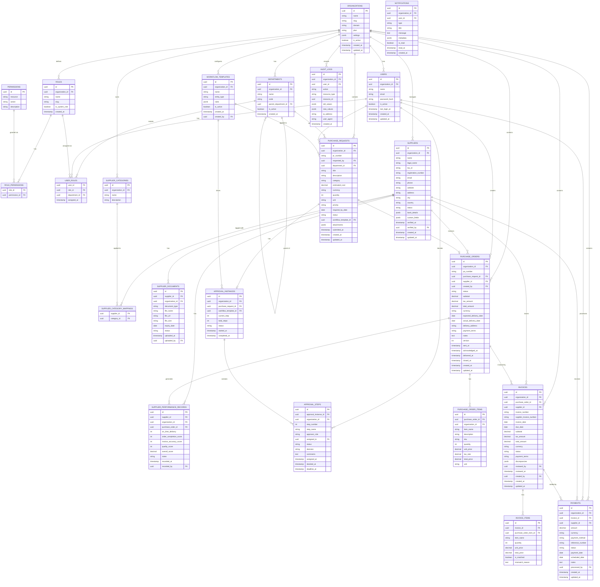

# Deliverable 02 — Database Design
# SupplyMesh: Global Procurement & Supplier Intelligence Platform

---

## 1. Database Technology Decision

**Selected: PostgreSQL 15+**

SupplyMesh manages deeply relational data: Organizations → Departments → Users → Purchase Requests → Approval Steps → Purchase Orders → Invoices → Payments. These entities have strict referential integrity requirements and financial transactions demand ACID compliance. PostgreSQL provides:

- Full ACID transactions across multiple tables
- Advanced constraint enforcement (CHECK, FOREIGN KEY, UNIQUE)
- JSON columns for flexible metadata (workflow rules, supplier custom fields)
- Row-Level Security (RLS) for multi-tenant data isolation
- Powerful indexing (B-tree, partial, composite)
- Native UUID support

**ORM: Drizzle ORM** — Type-safe, SQL-first, lightweight. No "magic" like Prisma's query engine. Generates raw SQL that can be audited and optimized directly.

---

## 2. Multi-Tenant Architecture Strategy

**Strategy: Shared Database, Shared Schema with `organization_id` Row-Level Isolation**

Every tenant-scoped table includes an `organization_id` column. All queries are automatically filtered by the authenticated user's `organization_id`.

**Why this approach:**
- Simpler deployment (one database)
- Easier cross-tenant analytics for SaaS operator
- PostgreSQL Row-Level Security enforces isolation at DB level as a safety net
- Cost-effective for MVP; can shard by org later

**Tenant Isolation Layers:**
1. **Application Layer**: Every service function receives `orgId` from JWT and scopes all queries
2. **Database Layer**: PostgreSQL RLS policies on all tenant tables as backup enforcement
3. **API Layer**: Middleware validates `organization_id` matches authenticated user's org

---

## 3. Complete ER Diagram



---

## 4. Table Definitions

### `organizations`
| Column | Type | Constraints | Description |
|--------|------|-------------|-------------|
| id | UUID | PK, DEFAULT gen_random_uuid() | Unique identifier |
| name | VARCHAR(255) | NOT NULL | Organization display name |
| slug | VARCHAR(100) | UNIQUE, NOT NULL | URL-safe identifier |
| domain | VARCHAR(255) | UNIQUE | Email domain for auto-join |
| plan | VARCHAR(50) | DEFAULT 'starter' | Subscription plan |
| settings | JSONB | DEFAULT '{}' | Org-level configs (currency, timezone, etc.) |
| is_active | BOOLEAN | DEFAULT true | Soft disable |
| created_at | TIMESTAMPTZ | DEFAULT NOW() | |
| updated_at | TIMESTAMPTZ | DEFAULT NOW() | |

**Indexes**: `idx_organizations_slug` (UNIQUE), `idx_organizations_domain`

---

### `departments`
| Column | Type | Constraints | Description |
|--------|------|-------------|-------------|
| id | UUID | PK | |
| organization_id | UUID | FK → organizations.id, NOT NULL | Tenant scope |
| name | VARCHAR(255) | NOT NULL | |
| code | VARCHAR(50) | | Short code (e.g., "ENG", "FIN") |
| parent_department_id | UUID | FK → departments.id, NULLABLE | Hierarchical departments |
| is_active | BOOLEAN | DEFAULT true | |
| created_at | TIMESTAMPTZ | DEFAULT NOW() | |

**Indexes**: `idx_departments_org_id`, `idx_departments_parent_id`
**Constraint**: `UNIQUE(organization_id, code)` — no duplicate dept codes per org

---

### `users`
| Column | Type | Constraints | Description |
|--------|------|-------------|-------------|
| id | UUID | PK | |
| organization_id | UUID | FK → organizations.id, NOT NULL | Tenant scope |
| name | VARCHAR(255) | NOT NULL | |
| email | VARCHAR(255) | NOT NULL | |
| password_hash | TEXT | NOT NULL | bcrypt hash |
| is_active | BOOLEAN | DEFAULT true | |
| last_login_at | TIMESTAMPTZ | NULLABLE | |
| created_at | TIMESTAMPTZ | DEFAULT NOW() | |
| updated_at | TIMESTAMPTZ | DEFAULT NOW() | |

**Indexes**: `idx_users_org_id`, `idx_users_email`
**Constraint**: `UNIQUE(organization_id, email)` — unique email per org (not global)

---

### `roles`
| Column | Type | Constraints | Description |
|--------|------|-------------|-------------|
| id | UUID | PK | |
| organization_id | UUID | FK → organizations.id | Tenant scope (NULL for system roles) |
| name | VARCHAR(100) | NOT NULL | Display name |
| slug | VARCHAR(100) | NOT NULL | Machine-readable identifier |
| is_system_role | BOOLEAN | DEFAULT false | System roles cannot be deleted |
| created_at | TIMESTAMPTZ | DEFAULT NOW() | |

**Constraint**: `UNIQUE(organization_id, slug)`

---

### `permissions`
| Column | Type | Constraints | Description |
|--------|------|-------------|-------------|
| id | UUID | PK | |
| resource | VARCHAR(100) | NOT NULL | e.g., "purchase_request" |
| action | VARCHAR(50) | NOT NULL | e.g., "create", "approve", "read" |
| description | TEXT | | Human-readable description |

**Constraint**: `UNIQUE(resource, action)`

---

### `role_permissions`
| Column | Type | Constraints |
|--------|------|-------------|
| role_id | UUID | FK → roles.id, NOT NULL |
| permission_id | UUID | FK → permissions.id, NOT NULL |

**Constraint**: `PRIMARY KEY(role_id, permission_id)`

---

### `user_roles`
| Column | Type | Constraints | Description |
|--------|------|-------------|-------------|
| user_id | UUID | FK → users.id, NOT NULL | |
| role_id | UUID | FK → roles.id, NOT NULL | |
| department_id | UUID | FK → departments.id, NULLABLE | Dept-scoped role |
| assigned_at | TIMESTAMPTZ | DEFAULT NOW() | |

**Constraint**: `PRIMARY KEY(user_id, role_id, department_id)`

---

### `suppliers`
| Column | Type | Constraints | Description |
|--------|------|-------------|-------------|
| id | UUID | PK | |
| organization_id | UUID | FK → organizations.id | Tenant scope |
| name | VARCHAR(255) | NOT NULL | Trading name |
| legal_name | VARCHAR(255) | | Registered legal name |
| tax_id | VARCHAR(100) | | VAT/EIN/TIN |
| registration_number | VARCHAR(100) | | Business registration |
| email | VARCHAR(255) | NOT NULL | Primary contact email |
| phone | VARCHAR(50) | | |
| website | VARCHAR(255) | | |
| address | TEXT | | Full address |
| city | VARCHAR(100) | | |
| country | VARCHAR(100) | | ISO country code |
| status | VARCHAR(50) | DEFAULT 'pending_verification' | pending_verification / active / inactive / blacklisted |
| bank_details | JSONB | DEFAULT '{}' | Encrypted bank info |
| custom_fields | JSONB | DEFAULT '{}' | Org-defined extra fields |
| verified_at | TIMESTAMPTZ | NULLABLE | |
| verified_by | UUID | FK → users.id, NULLABLE | |
| created_at | TIMESTAMPTZ | DEFAULT NOW() | |
| updated_at | TIMESTAMPTZ | DEFAULT NOW() | |

**Indexes**: `idx_suppliers_org_id`, `idx_suppliers_status`, `idx_suppliers_country`
**Constraint**: `UNIQUE(organization_id, tax_id)` where tax_id IS NOT NULL

---

### `supplier_documents`
| Column | Type | Constraints | Description |
|--------|------|-------------|-------------|
| id | UUID | PK | |
| supplier_id | UUID | FK → suppliers.id, NOT NULL | |
| organization_id | UUID | FK → organizations.id | Tenant scope |
| document_type | VARCHAR(100) | NOT NULL | license / certificate / insurance / tax_clearance |
| file_name | VARCHAR(255) | NOT NULL | Original filename |
| file_url | TEXT | NOT NULL | S3/storage URL |
| file_size | VARCHAR(50) | | |
| expiry_date | DATE | NULLABLE | For auto-expiry alerts |
| status | VARCHAR(50) | DEFAULT 'active' | active / expired / superseded |
| uploaded_at | TIMESTAMPTZ | DEFAULT NOW() | |
| uploaded_by | UUID | FK → users.id | |

---

### `supplier_performance_records`
| Column | Type | Constraints | Description |
|--------|------|-------------|-------------|
| id | UUID | PK | |
| supplier_id | UUID | FK → suppliers.id | |
| organization_id | UUID | FK → organizations.id | |
| purchase_order_id | UUID | FK → purchase_orders.id | Linked PO |
| on_time_delivery | SMALLINT | CHECK (0-100) | % score |
| order_completion_score | SMALLINT | CHECK (0-100) | |
| invoice_accuracy_score | SMALLINT | CHECK (0-100) | |
| quality_score | SMALLINT | CHECK (0-100) | |
| overall_score | DECIMAL(5,2) | | Weighted composite |
| notes | TEXT | | |
| recorded_at | TIMESTAMPTZ | DEFAULT NOW() | |
| recorded_by | UUID | FK → users.id | |

---

### `workflow_templates`
| Column | Type | Constraints | Description |
|--------|------|-------------|-------------|
| id | UUID | PK | |
| organization_id | UUID | FK → organizations.id | Tenant scope |
| name | VARCHAR(255) | NOT NULL | |
| entity_type | VARCHAR(100) | NOT NULL | purchase_request / purchase_order |
| rules | JSONB | NOT NULL | Threshold + step definitions |
| is_active | BOOLEAN | DEFAULT true | |
| created_at | TIMESTAMPTZ | DEFAULT NOW() | |
| created_by | UUID | FK → users.id | |

**Example `rules` JSONB:**
```json
{
  "steps": [
    { "step": 1, "name": "Department Approval", "role": "department_manager", "max_amount": 500 },
    { "step": 2, "name": "Procurement Approval", "role": "procurement_manager", "max_amount": 5000 },
    { "step": 3, "name": "Finance Approval", "role": "finance_officer", "max_amount": null }
  ],
  "escalation_hours": 24
}
```

---

### `purchase_requests`
| Column | Type | Constraints | Description |
|--------|------|-------------|-------------|
| id | UUID | PK | |
| organization_id | UUID | FK → organizations.id | |
| pr_number | VARCHAR(50) | UNIQUE, NOT NULL | Auto-generated: PR-{ORG}-{YEAR}-{SEQ} |
| requested_by | UUID | FK → users.id | |
| department_id | UUID | FK → departments.id | |
| title | VARCHAR(500) | NOT NULL | |
| description | TEXT | | |
| category | VARCHAR(100) | | |
| estimated_cost | DECIMAL(15,2) | NOT NULL | |
| currency | VARCHAR(3) | DEFAULT 'USD' | ISO 4217 |
| quantity | INTEGER | DEFAULT 1 | |
| unit | VARCHAR(50) | | pcs / kg / hours |
| priority | VARCHAR(20) | DEFAULT 'medium' | low / medium / high / urgent |
| required_by_date | DATE | NOT NULL | |
| status | VARCHAR(50) | DEFAULT 'draft' | draft / submitted / under_review / approved / rejected / cancelled |
| workflow_template_id | UUID | FK → workflow_templates.id | |
| attachments | JSONB | DEFAULT '[]' | Array of file URLs |
| submitted_at | TIMESTAMPTZ | NULLABLE | |
| created_at | TIMESTAMPTZ | DEFAULT NOW() | |
| updated_at | TIMESTAMPTZ | DEFAULT NOW() | |

**Indexes**: `idx_pr_org_id`, `idx_pr_requested_by`, `idx_pr_department_id`, `idx_pr_status`, `idx_pr_number`

---

### `approval_instances`
| Column | Type | Constraints | Description |
|--------|------|-------------|-------------|
| id | UUID | PK | |
| organization_id | UUID | FK → organizations.id | |
| purchase_request_id | UUID | FK → purchase_requests.id, UNIQUE | One instance per PR |
| workflow_template_id | UUID | FK → workflow_templates.id | |
| current_step | SMALLINT | DEFAULT 1 | |
| total_steps | SMALLINT | NOT NULL | |
| status | VARCHAR(50) | DEFAULT 'in_progress' | in_progress / approved / rejected / cancelled |
| started_at | TIMESTAMPTZ | DEFAULT NOW() | |
| completed_at | TIMESTAMPTZ | NULLABLE | |

---

### `approval_steps`
| Column | Type | Constraints | Description |
|--------|------|-------------|-------------|
| id | UUID | PK | |
| approval_instance_id | UUID | FK → approval_instances.id | |
| organization_id | UUID | FK → organizations.id | |
| step_number | SMALLINT | NOT NULL | |
| step_name | VARCHAR(255) | | |
| approver_role | VARCHAR(100) | | Required role for this step |
| assigned_to | UUID | FK → users.id, NULLABLE | Specific assignee |
| status | VARCHAR(50) | DEFAULT 'pending' | pending / approved / rejected / skipped |
| decision | VARCHAR(50) | NULLABLE | approved / rejected |
| comments | TEXT | NULLABLE | |
| assigned_at | TIMESTAMPTZ | DEFAULT NOW() | |
| decided_at | TIMESTAMPTZ | NULLABLE | |
| deadline_at | TIMESTAMPTZ | NULLABLE | SLA deadline |

**Constraint**: `UNIQUE(approval_instance_id, step_number)`

---

### `purchase_orders`
| Column | Type | Constraints | Description |
|--------|------|-------------|-------------|
| id | UUID | PK | |
| organization_id | UUID | FK → organizations.id | |
| po_number | VARCHAR(50) | UNIQUE, NOT NULL | PO-{ORG}-{YEAR}-{SEQ} |
| purchase_request_id | UUID | FK → purchase_requests.id, NULLABLE | Source PR |
| supplier_id | UUID | FK → suppliers.id, NOT NULL | |
| created_by | UUID | FK → users.id | |
| status | VARCHAR(50) | DEFAULT 'draft' | draft / sent / acknowledged / in_progress / delivered / closed / cancelled |
| subtotal | DECIMAL(15,2) | NOT NULL | |
| tax_amount | DECIMAL(15,2) | DEFAULT 0 | |
| total_amount | DECIMAL(15,2) | NOT NULL | |
| currency | VARCHAR(3) | DEFAULT 'USD' | |
| expected_delivery_date | DATE | | |
| actual_delivery_date | DATE | NULLABLE | |
| delivery_address | TEXT | | |
| payment_terms | VARCHAR(50) | DEFAULT 'net30' | |
| notes | TEXT | | |
| version | SMALLINT | DEFAULT 1 | For amendments |
| sent_at | TIMESTAMPTZ | NULLABLE | |
| acknowledged_at | TIMESTAMPTZ | NULLABLE | |
| delivered_at | TIMESTAMPTZ | NULLABLE | |
| closed_at | TIMESTAMPTZ | NULLABLE | |
| created_at | TIMESTAMPTZ | DEFAULT NOW() | |
| updated_at | TIMESTAMPTZ | DEFAULT NOW() | |

**Indexes**: `idx_po_org_id`, `idx_po_supplier_id`, `idx_po_status`, `idx_po_number`

---

### `purchase_order_items`
| Column | Type | Constraints | Description |
|--------|------|-------------|-------------|
| id | UUID | PK | |
| purchase_order_id | UUID | FK → purchase_orders.id | |
| organization_id | UUID | FK → organizations.id | |
| item_name | VARCHAR(500) | NOT NULL | |
| description | TEXT | | |
| sku | VARCHAR(100) | NULLABLE | |
| quantity | INTEGER | NOT NULL, CHECK (> 0) | |
| unit_price | DECIMAL(15,4) | NOT NULL | |
| tax_rate | DECIMAL(5,2) | DEFAULT 0 | |
| total_price | DECIMAL(15,2) | GENERATED | quantity × unit_price |
| unit | VARCHAR(50) | | |

---

### `invoices`
| Column | Type | Constraints | Description |
|--------|------|-------------|-------------|
| id | UUID | PK | |
| organization_id | UUID | FK → organizations.id | |
| purchase_order_id | UUID | FK → purchase_orders.id | |
| supplier_id | UUID | FK → suppliers.id | |
| invoice_number | VARCHAR(100) | NOT NULL | Internal reference |
| supplier_invoice_number | VARCHAR(100) | NOT NULL | Supplier's own invoice number |
| invoice_date | DATE | NOT NULL | |
| due_date | DATE | NOT NULL | |
| subtotal | DECIMAL(15,2) | NOT NULL | |
| tax_amount | DECIMAL(15,2) | DEFAULT 0 | |
| total_amount | DECIMAL(15,2) | NOT NULL | |
| currency | VARCHAR(3) | DEFAULT 'USD' | |
| status | VARCHAR(50) | DEFAULT 'pending_review' | pending_review / matched / discrepancy / approved / rejected / paid |
| payment_terms | VARCHAR(50) | | |
| discrepancies | JSONB | DEFAULT '[]' | Mismatch details |
| reviewed_by | UUID | FK → users.id, NULLABLE | |
| reviewed_at | TIMESTAMPTZ | NULLABLE | |
| created_by | UUID | FK → users.id | |
| created_at | TIMESTAMPTZ | DEFAULT NOW() | |
| updated_at | TIMESTAMPTZ | DEFAULT NOW() | |

**Constraint**: `UNIQUE(organization_id, supplier_id, supplier_invoice_number)` — prevents duplicate invoices
**Indexes**: `idx_invoices_org_id`, `idx_invoices_po_id`, `idx_invoices_status`

---

### `invoice_items`
| Column | Type | Constraints | Description |
|--------|------|-------------|-------------|
| id | UUID | PK | |
| invoice_id | UUID | FK → invoices.id | |
| purchase_order_item_id | UUID | FK → purchase_order_items.id, NULLABLE | Matching PO line |
| item_name | VARCHAR(500) | NOT NULL | |
| quantity | INTEGER | NOT NULL | |
| unit_price | DECIMAL(15,4) | NOT NULL | |
| total_price | DECIMAL(15,2) | NOT NULL | |
| is_matched | BOOLEAN | DEFAULT false | |
| mismatch_reason | TEXT | NULLABLE | |

---

### `payments`
| Column | Type | Constraints | Description |
|--------|------|-------------|-------------|
| id | UUID | PK | |
| organization_id | UUID | FK → organizations.id | |
| invoice_id | UUID | FK → invoices.id | |
| supplier_id | UUID | FK → suppliers.id | |
| amount | DECIMAL(15,2) | NOT NULL | |
| currency | VARCHAR(3) | DEFAULT 'USD' | |
| payment_method | VARCHAR(50) | | bank_transfer / check / credit_card |
| reference_number | VARCHAR(255) | | Bank reference |
| status | VARCHAR(50) | DEFAULT 'pending' | pending / scheduled / processed / completed / failed |
| payment_date | DATE | NULLABLE | Actual payment date |
| scheduled_date | DATE | NULLABLE | Planned date |
| notes | TEXT | | |
| processed_by | UUID | FK → users.id | |
| created_at | TIMESTAMPTZ | DEFAULT NOW() | |
| updated_at | TIMESTAMPTZ | DEFAULT NOW() | |

**Constraint**: `CHECK(amount > 0)` — no zero or negative payments

---

### `audit_logs`
| Column | Type | Constraints | Description |
|--------|------|-------------|-------------|
| id | UUID | PK | |
| organization_id | UUID | FK → organizations.id | |
| user_id | UUID | FK → users.id | Actor |
| action | VARCHAR(100) | NOT NULL | CREATE / UPDATE / DELETE / APPROVE / REJECT |
| resource_type | VARCHAR(100) | NOT NULL | Table name |
| resource_id | UUID | NOT NULL | Record ID |
| old_values | JSONB | NULLABLE | Previous state |
| new_values | JSONB | NULLABLE | New state |
| ip_address | INET | NULLABLE | |
| user_agent | TEXT | NULLABLE | |
| created_at | TIMESTAMPTZ | DEFAULT NOW() | |

**Indexes**: `idx_audit_org_id`, `idx_audit_resource`, `idx_audit_user_id`, `idx_audit_created_at` (for time-range queries)

> **Note**: Audit logs are append-only. No UPDATE or DELETE permissions granted on this table.

---

### `notifications`
| Column | Type | Constraints | Description |
|--------|------|-------------|-------------|
| id | UUID | PK | |
| organization_id | UUID | FK → organizations.id | |
| user_id | UUID | FK → users.id | Recipient |
| type | VARCHAR(100) | NOT NULL | approval_required / po_sent / invoice_flagged |
| title | VARCHAR(500) | NOT NULL | |
| message | TEXT | NOT NULL | |
| metadata | JSONB | DEFAULT '{}' | Link to resource |
| is_read | BOOLEAN | DEFAULT false | |
| read_at | TIMESTAMPTZ | NULLABLE | |
| created_at | TIMESTAMPTZ | DEFAULT NOW() | |

**Index**: `idx_notifications_user_unread` — `(user_id, is_read)` WHERE `is_read = false`

---

## 5. Indexing Strategy

### Composite Indexes for Common Query Patterns

```sql
-- Most frequent: list all PRs for an org, filtered by status
CREATE INDEX idx_pr_org_status ON purchase_requests(organization_id, status);

-- Approval dashboard: find pending steps for a user
CREATE INDEX idx_approval_steps_assignee_status
  ON approval_steps(assigned_to, status)
  WHERE status = 'pending';

-- Finance: invoices by org + status
CREATE INDEX idx_invoices_org_status ON invoices(organization_id, status);

-- Supplier performance lookup
CREATE INDEX idx_perf_supplier_org ON supplier_performance_records(supplier_id, organization_id);

-- Analytics: PO spending by org + date range
CREATE INDEX idx_po_org_created ON purchase_orders(organization_id, created_at);

-- Audit log search
CREATE INDEX idx_audit_resource_type_id ON audit_logs(resource_type, resource_id);
```

---

## 6. Data Normalization Decisions

| Decision | Rationale |
|----------|-----------|
| Separate `invoice_items` from `invoices` | Enables line-level matching against PO items |
| `workflow_template.rules` stored as JSONB | Workflow rules are flexible and org-specific; no fixed schema |
| `supplier.bank_details` stored as JSONB | Bank fields vary by country (SWIFT, IBAN, ACH, etc.) |
| `purchase_requests.attachments` as JSONB | Variable number of files; no need for a full join table |
| Separate `approval_instances` and `approval_steps` | Instance = the lifecycle, Steps = individual decisions. Clean separation. |
| `audit_logs.old_values/new_values` as JSONB | Captures any entity state without schema coupling |

---

## 7. Handling Data Growth

| Strategy | Implementation |
|----------|---------------|
| **Partitioning** | `audit_logs` and `notifications` partitioned by `created_at` (monthly partitions) |
| **Archiving** | Closed POs and paid invoices older than 2 years moved to archive tables |
| **Connection Pooling** | PgBouncer in transaction mode; max 20 connections per app instance |
| **Read Replicas** | Analytics queries routed to read replica; write queries to primary |
| **Tenant Sharding (Future)** | Large tenants can be isolated to dedicated database instances using the same schema |
