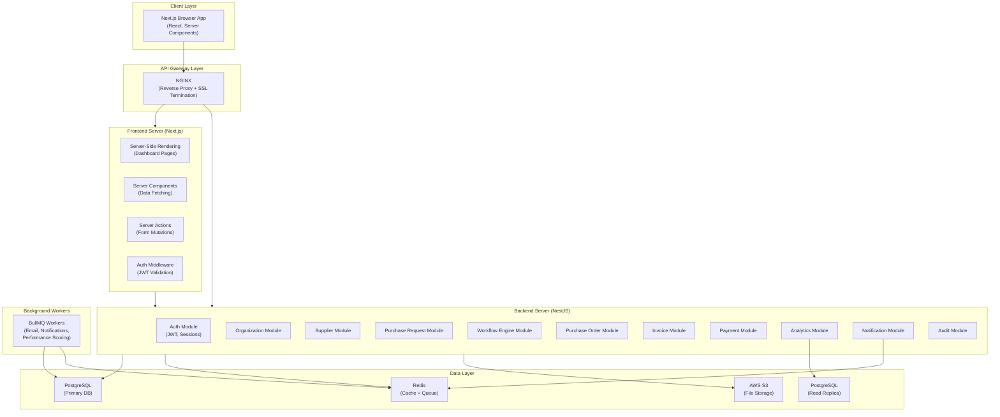
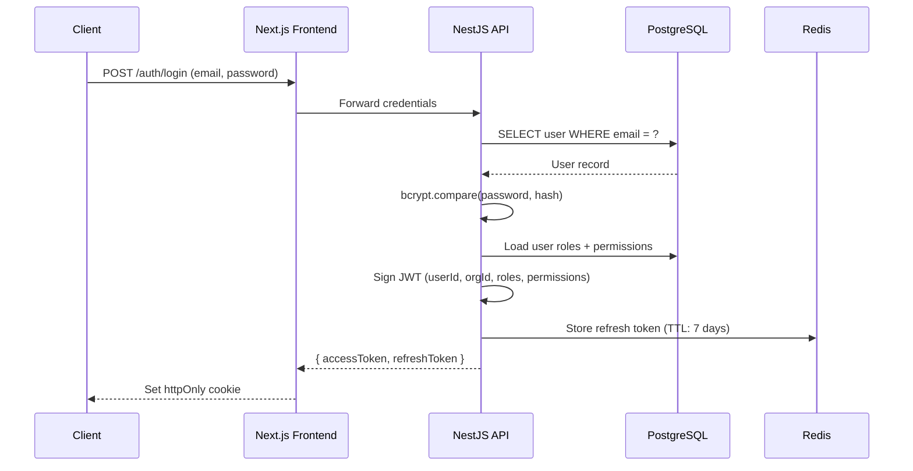
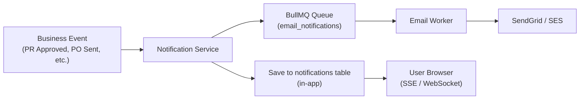
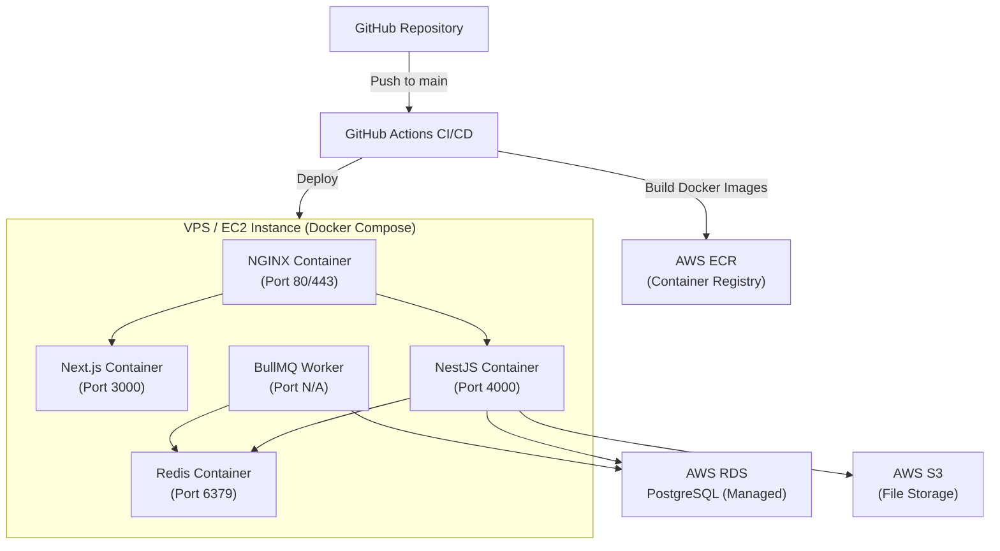

# Deliverable 03 — Application Architecture
# SupplyMesh: Global Procurement & Supplier Intelligence Platform

---

## 1. Architecture Decision: Modular Monolith

After evaluating three options, I chose **Modular Monolithic Architecture** for SupplyMesh.

### Options Evaluated

| Architecture | Why Rejected |
|-------------|-------------|
| **Microservices** | At MVP stage, the team is small, the domain boundaries are still being discovered, and the operational overhead (service discovery, distributed tracing, inter-service auth, network latency) is disproportionate to the benefits. Microservices make sense when you have proven, stable domain boundaries and multiple independent teams. We have neither yet. |
| **Service-Oriented Architecture** | SOA is essentially a heavier, enterprise version of microservices with SOAP/XML contracts. Inappropriate for a modern SaaS product. |
| **Modular Monolith (Selected)** | A single deployable unit, divided into strict, cohesive modules with clearly defined boundaries. Each module owns its domain logic, database access, and API surface. Modules communicate via internal service interfaces — not direct database joins or HTTP calls. This gives us the organizational clarity of microservices without the operational complexity. When a module needs to scale independently (e.g., the notification engine), it can be extracted into a separate service with minimal refactoring. |

### Why Modular Monolith Is Right for SupplyMesh

1. **Domain boundaries are relational** — Suppliers, POs, Invoices, and Payments are deeply interconnected. Splitting them into microservices at this stage would require distributed transactions (Sagas), which are complex and error-prone.
2. **Team size** — A single team can maintain one deployable unit with shared tooling.
3. **Financial data consistency** — PO → Invoice → Payment must be transactionally consistent. Monolith enables database-level transactions across these entities.
4. **Extractable when needed** — The Notification engine and Analytics engine are natural extraction candidates in Phase 2.

---

## 2. High-Level Architecture Diagram



---

## 3. Frontend Architecture (Next.js 14)

### Technology Stack
- **Framework**: Next.js 14 (App Router)
- **Language**: TypeScript
- **Styling**: Tailwind CSS + shadcn/ui
- **State Management**: React Server Components (server state) + Zustand (client UI state)
- **Forms**: React Hook Form + Zod validation
- **Data Fetching**: Server Components for initial load; SWR/React Query for client-side mutations
- **Auth**: NextAuth.js or custom JWT interceptor

### Directory Structure
```
src/
├── app/                          # Next.js App Router
│   ├── (public)/                 # Unauthenticated routes
│   │   ├── login/
│   │   └── register/
│   ├── (platform)/               # Authenticated routes
│   │   ├── layout.tsx            # Auth guard + org context
│   │   ├── dashboard/            # Overview
│   │   ├── suppliers/
│   │   ├── purchase-requests/
│   │   ├── purchase-orders/
│   │   ├── invoices/
│   │   ├── payments/
│   │   ├── analytics/
│   │   └── settings/
│   │       ├── organization/
│   │       ├── departments/
│   │       ├── users/
│   │       └── workflows/
├── components/
│   ├── ui/                       # shadcn/ui base components
│   ├── layout/                   # Sidebar, Topbar, Breadcrumb
│   ├── suppliers/
│   ├── purchase-requests/
│   ├── purchase-orders/
│   ├── invoices/
│   └── shared/
├── lib/
│   ├── api/                      # API client (axios/fetch wrappers)
│   ├── auth/                     # Auth utilities
│   ├── validations/              # Zod schemas (shared with backend types)
│   └── utils/
└── types/                        # Shared TypeScript types
```

### Rendering Strategy
| Page Type | Strategy | Reason |
|-----------|----------|--------|
| Dashboard / Analytics | SSR | Fresh data on each load; SEO not needed but fast TTFB |
| Supplier List | SSR + Client pagination | Initial data SSR, subsequent pages client-side |
| PO Detail Page | SSR | Authoritative data, no stale cache |
| Form Pages | CSR | Interactive; no SEO value |
| Settings | SSR | Low-traffic, accuracy over performance |

---

## 4. Backend Architecture (NestJS)

### Technology Stack
- **Framework**: NestJS (Node.js, Express under the hood)
- **Language**: TypeScript
- **ORM**: Drizzle ORM
- **Validation**: class-validator + class-transformer (DTO validation)
- **Auth**: Passport.js (JWT strategy)
- **Queue**: BullMQ (Redis-backed)
- **Testing**: Jest + Supertest

### Why NestJS over plain Express?
NestJS provides:
- Dependency injection container → testable, loosely coupled services
- Module system → enforces domain boundaries (aligns with modular monolith strategy)
- Decorators-based validation, guards, interceptors → consistent cross-cutting concerns
- OpenAPI/Swagger generation → automatic API documentation

### Module Structure
```
src/
├── common/                       # Shared utilities, decorators, guards
│   ├── guards/
│   │   ├── jwt-auth.guard.ts
│   │   └── permissions.guard.ts
│   ├── decorators/
│   │   ├── current-user.decorator.ts
│   │   └── require-permission.decorator.ts
│   ├── interceptors/
│   │   ├── audit.interceptor.ts
│   │   └── transform.interceptor.ts
│   ├── filters/
│   │   └── http-exception.filter.ts
│   └── pipes/
│       └── zod-validation.pipe.ts
│
├── database/                     # Drizzle setup, schema, migrations
│   ├── drizzle.config.ts
│   ├── schema/                   # All table definitions
│   │   ├── organizations.ts
│   │   ├── users.ts
│   │   ├── suppliers.ts
│   │   ├── purchase-requests.ts
│   │   ├── purchase-orders.ts
│   │   ├── invoices.ts
│   │   └── ...
│   └── migrations/
│
├── modules/
│   ├── auth/
│   │   ├── auth.module.ts
│   │   ├── auth.controller.ts
│   │   ├── auth.service.ts
│   │   ├── strategies/
│   │   │   └── jwt.strategy.ts
│   │   └── dto/
│   │
│   ├── organizations/
│   │   ├── organizations.module.ts
│   │   ├── organizations.controller.ts
│   │   └── organizations.service.ts
│   │
│   ├── suppliers/
│   │   ├── suppliers.module.ts
│   │   ├── suppliers.controller.ts
│   │   ├── suppliers.service.ts
│   │   ├── supplier-documents.service.ts
│   │   ├── supplier-performance.service.ts
│   │   └── dto/
│   │
│   ├── purchase-requests/
│   │   ├── purchase-requests.module.ts
│   │   ├── purchase-requests.controller.ts
│   │   └── purchase-requests.service.ts
│   │
│   ├── workflow/
│   │   ├── workflow.module.ts
│   │   ├── workflow-engine.service.ts
│   │   ├── workflow-templates.service.ts
│   │   └── approval.service.ts
│   │
│   ├── purchase-orders/
│   ├── invoices/
│   ├── payments/
│   ├── analytics/
│   ├── notifications/
│   └── audit/
│
└── main.ts
```

---

## 5. API Structure

### Base URL
```
https://api.supplymesh.io/v1
```

### Authentication
All API routes (except `/auth/*`) require:
```
Authorization: Bearer <JWT_TOKEN>
```

### API Conventions
- RESTful resource-based routing
- Consistent response envelope:
```json
{
  "success": true,
  "data": {},
  "meta": { "page": 1, "limit": 20, "total": 150 },
  "timestamp": "2026-11-16T08:00:00Z"
}
```
- Error response:
```json
{
  "success": false,
  "error": {
    "code": "FORBIDDEN",
    "message": "You do not have permission to approve this request",
    "details": []
  },
  "timestamp": "2026-11-16T08:00:00Z"
}
```

### Key API Endpoints

#### Auth
| Method | Endpoint | Description |
|--------|----------|-------------|
| POST | `/auth/login` | Email/password login → returns JWT |
| POST | `/auth/logout` | Invalidate token |
| POST | `/auth/refresh` | Refresh JWT |
| POST | `/auth/register` | Register new organization + owner |

#### Suppliers
| Method | Endpoint | Description |
|--------|----------|-------------|
| GET | `/suppliers` | List suppliers (filterable by status, category) |
| POST | `/suppliers` | Create supplier |
| GET | `/suppliers/:id` | Supplier detail |
| PATCH | `/suppliers/:id` | Update supplier |
| PATCH | `/suppliers/:id/verify` | Mark supplier as verified |
| PATCH | `/suppliers/:id/status` | Change status (active/inactive/blacklist) |
| POST | `/suppliers/:id/documents` | Upload document |
| GET | `/suppliers/:id/performance` | Performance history |

#### Purchase Requests
| Method | Endpoint | Description |
|--------|----------|-------------|
| GET | `/purchase-requests` | List (filterable) |
| POST | `/purchase-requests` | Create draft |
| GET | `/purchase-requests/:id` | Detail |
| PATCH | `/purchase-requests/:id` | Update draft |
| POST | `/purchase-requests/:id/submit` | Submit for approval |
| POST | `/purchase-requests/:id/cancel` | Cancel |

#### Approvals
| Method | Endpoint | Description |
|--------|----------|-------------|
| GET | `/approvals/pending` | My pending approvals |
| POST | `/approvals/:stepId/approve` | Approve step |
| POST | `/approvals/:stepId/reject` | Reject step |

#### Purchase Orders
| Method | Endpoint | Description |
|--------|----------|-------------|
| GET | `/purchase-orders` | List |
| POST | `/purchase-orders` | Create |
| GET | `/purchase-orders/:id` | Detail |
| PATCH | `/purchase-orders/:id` | Update |
| POST | `/purchase-orders/:id/send` | Send to supplier |
| POST | `/purchase-orders/:id/deliver` | Mark delivered |
| POST | `/purchase-orders/:id/close` | Close PO |

#### Invoices
| Method | Endpoint | Description |
|--------|----------|-------------|
| GET | `/invoices` | List |
| POST | `/invoices` | Record invoice |
| GET | `/invoices/:id` | Detail |
| POST | `/invoices/:id/match` | Trigger PO matching |
| POST | `/invoices/:id/approve` | Approve invoice |
| POST | `/invoices/:id/reject` | Reject invoice |

#### Analytics
| Method | Endpoint | Description |
|--------|----------|-------------|
| GET | `/analytics/overview` | Org-wide KPIs |
| GET | `/analytics/spending` | Spending breakdown |
| GET | `/analytics/suppliers/performance` | Supplier performance rankings |
| GET | `/analytics/approval-times` | Approval SLA metrics |

---

## 6. Authentication & Authorization Architecture

### Authentication Flow


### JWT Payload Structure
```json
{
  "sub": "user-uuid",
  "orgId": "org-uuid",
  "email": "user@company.com",
  "roles": ["procurement_manager"],
  "permissions": ["supplier:create", "supplier:read", "purchase_request:approve"],
  "iat": 1700000000,
  "exp": 1700003600
}
```

### Authorization Architecture (RBAC)

**Two-Layer Authorization:**

1. **Route Level** (NestJS Guards):
```typescript
@UseGuards(JwtAuthGuard, PermissionsGuard)
@RequirePermission('purchase_request', 'approve')
@Post(':id/approve')
async approveRequest(@Param('id') id: string, @CurrentUser() user: JwtPayload) {
  ...
}
```

2. **Data Level** (Service Layer):
```typescript
// Ensure the resource belongs to the user's organization
const request = await this.db.query.purchaseRequests.findFirst({
  where: and(
    eq(purchaseRequests.id, id),
    eq(purchaseRequests.organizationId, user.orgId)  // ← ALWAYS enforced
  )
});
if (!request) throw new NotFoundException();
```

---

## 7. File/Document Storage

- **Provider**: AWS S3
- **Bucket structure**: `supplymesh-{env}/orgs/{orgId}/suppliers/{supplierId}/docs/`
- **Access**: Pre-signed URLs (15-minute expiry) — files are never publicly accessible
- **Upload flow**: Client requests pre-signed URL from API → Client uploads directly to S3 → Client confirms upload → API saves metadata to DB
- **Virus scanning**: AWS S3 Object Lambda + ClamAV scan on upload

---

## 8. Notification System



**Notification Triggers:**
| Event | Recipients | Channels |
|-------|-----------|---------|
| PR submitted | Approver(s) | In-app |
| PR approved/rejected | Requester | In-app |
| PO sent to supplier | Supplier contact (email) | Email |
| Invoice discrepancy detected | Finance Officer | In-app |
| Supplier document expiring (30 days) | Procurement Manager | In-app |
| Approval SLA breached | Approver + escalation target | In-app |

---

## 9. Background Processing (BullMQ + Redis)

| Queue | Job | Trigger |
|-------|-----|---------|
| `approval-escalation` | Check overdue approval steps | Cron: every 30 min |
| `performance-scoring` | Recalculate supplier scores | After PO closed |
| `document-expiry-check` | Scan for expiring supplier docs | Cron: daily |
| `notification-email` | Send email notifications | Event-driven |
| `audit-write` | Async audit log writes | After every mutation |

---

## 10. Caching Strategy (Redis)

| Cached Data | TTL | Invalidation |
|------------|-----|-------------|
| User permissions (from JWT) | JWT lifetime | On role change |
| Organization settings | 10 minutes | On settings update |
| Supplier list (per org) | 2 minutes | On supplier create/update |
| Analytics dashboard KPIs | 5 minutes | On significant data change |
| Pending approval count (per user) | 60 seconds | On approval action |

---

## 11. Deployment Architecture



### Docker Compose Services
```yaml
services:
  nginx:        # Reverse proxy, SSL termination
  frontend:     # Next.js (port 3000)
  backend:      # NestJS (port 4000)
  worker:       # BullMQ worker (same NestJS codebase, different entrypoint)
  redis:        # Redis (port 6379)
```

> PostgreSQL runs on **AWS RDS** (managed) — not in Docker — for reliability, automated backups, and read replicas.
