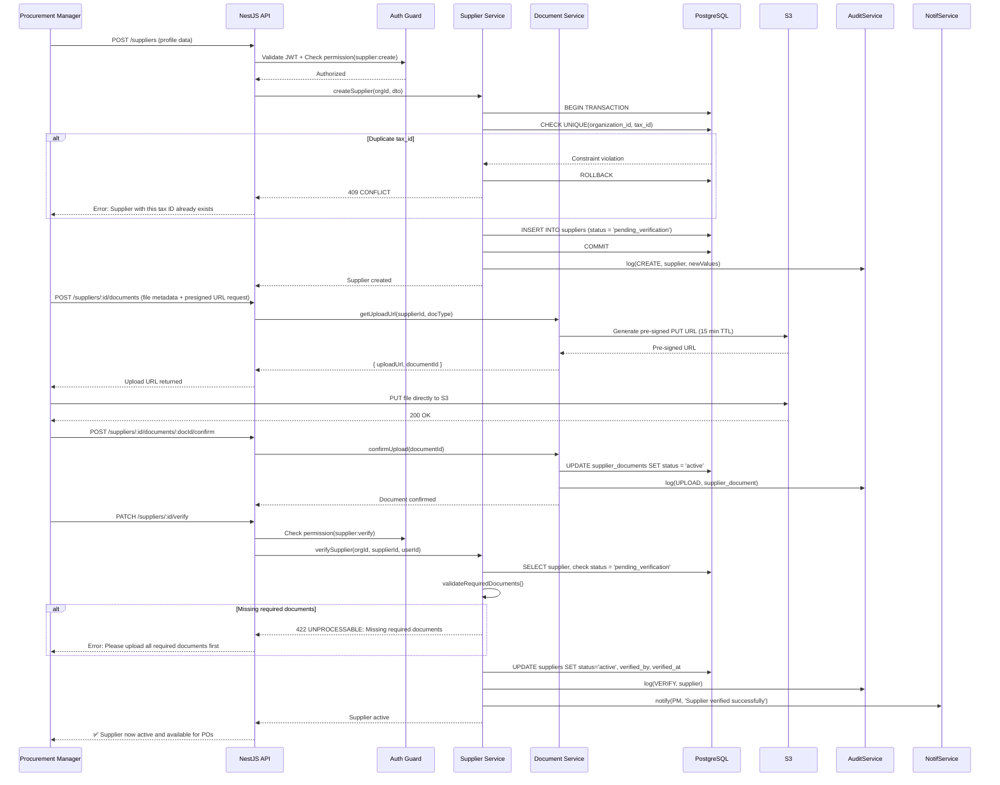
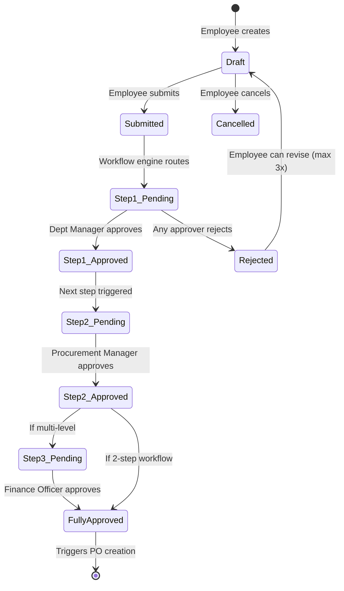
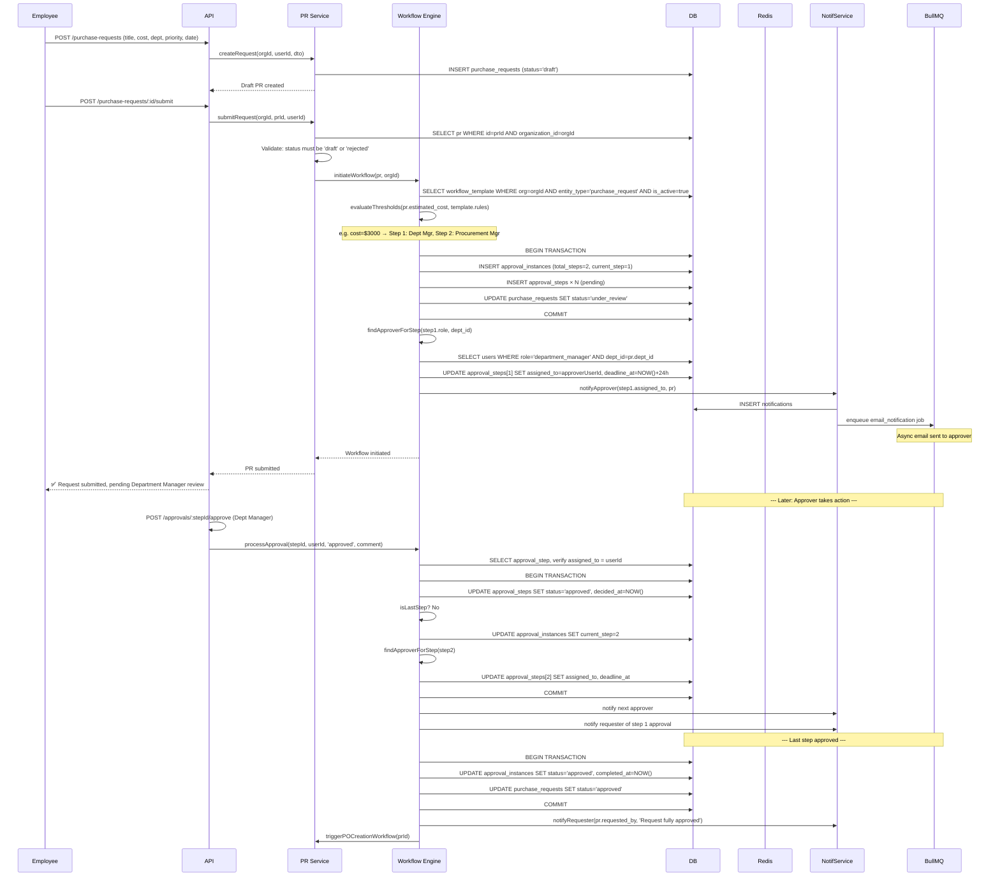
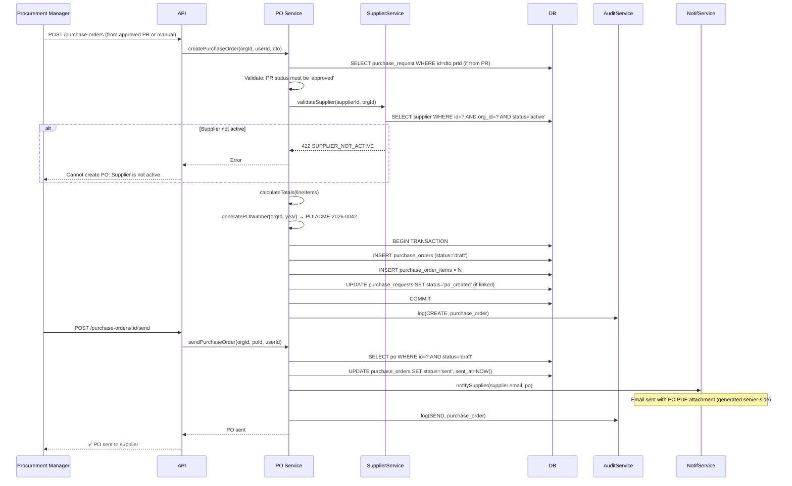
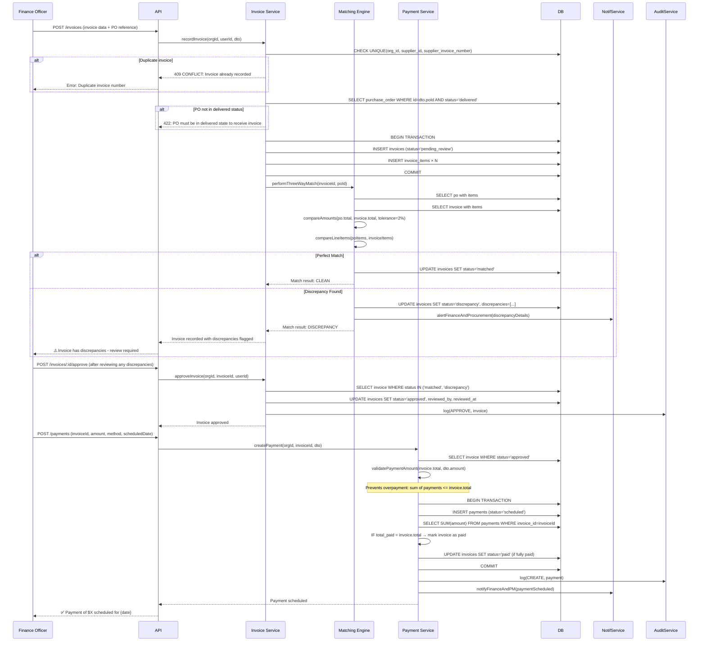
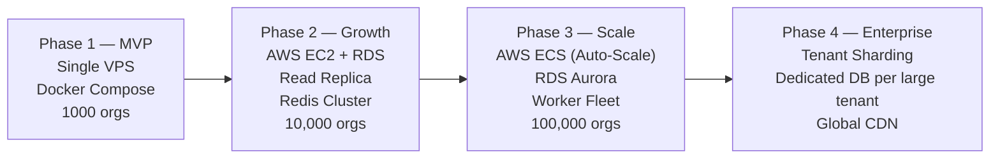

# Deliverable 04 — System Design
# SupplyMesh: Global Procurement & Supplier Intelligence Platform

---

## Overview

This document provides detailed system design for the four critical workflows in SupplyMesh. Each workflow is analyzed for request flow, business logic, database operations, authorization, failure handling, transaction management, and notification flow.

---

## Workflow 1: Supplier Registration & Verification

### 1.1 Request Flow



### 1.2 Business Logic
- A supplier cannot be verified unless all required document types are uploaded and not expired
- Required documents (configurable per org): Business License, Tax Clearance Certificate, Insurance Certificate
- Duplicate detection: `UNIQUE(organization_id, tax_id)` prevents double registration
- Blacklisted suppliers: if same `tax_id` or `email` matches a blacklisted entry in another org of the platform, an alert is raised (soft warning, not hard block)

### 1.3 Failure Scenarios & Handling

| Failure | Handling |
|---------|----------|
| S3 upload fails | Pre-signed URL expires; client retries. Document record stays in `pending_upload` state and is auto-cleaned after 24h |
| Verification attempted on blacklisted supplier | 403 FORBIDDEN with reason |
| Concurrent verification attempts | DB-level `SELECT FOR UPDATE` prevents race condition |
| File virus detected (ClamAV) | S3 Object Lambda deletes file; API receives webhook; document marked `quarantined` |

---

## Workflow 2: Purchase Request & Multi-Level Approval

### 2.1 State Machine



### 2.2 Detailed Request Flow



### 2.3 Workflow Engine Rules Resolution

```typescript
// Pseudo-code: Workflow Engine step resolution
function evaluateWorkflowSteps(cost: number, rules: WorkflowRule[]): ApprovalStep[] {
  const applicableRules = rules
    .filter(rule => cost <= (rule.max_amount ?? Infinity))
    .sort((a, b) => a.step - b.step);

  // e.g. cost = $3000:
  // Step 1: max_amount=500 → NOT applicable (3000 > 500 → actually step 1 is for ≤500 requests)
  // Actually, re-read: steps define who approves for requests UP TO that threshold
  // Better interpretation: each step has a MIN threshold
  // If cost ≥ step.min_threshold, include that step

  return applicableRules.map(rule => ({
    stepNumber: rule.step,
    stepName: rule.name,
    approverRole: rule.role,
    deadlineHours: rules.escalation_hours ?? 24
  }));
}
```

### 2.4 Failure Scenarios

| Failure | Handling |
|---------|----------|
| Approver is unavailable / deleted | System tries to find another user with same role in same dept; if none, escalate to org owner |
| SLA breach (no action in 24h) | BullMQ cron job runs every 30 min; escalates to next-level approver |
| Concurrent approval attempt | `SELECT FOR UPDATE` on approval_step prevents double-processing |
| Requester tries to cancel approved request | Business rule: cannot cancel if status is `approved` or PO already created |
| Circular approval (delegated to self) | Delegation guard prevents user delegating to themselves |

### 2.5 Database Operations Summary

```sql
-- Atomic workflow initiation
BEGIN;
  INSERT INTO approval_instances (...);
  INSERT INTO approval_steps (...) × N;
  UPDATE purchase_requests SET status = 'under_review' WHERE id = ?;
COMMIT;

-- Atomic step approval
BEGIN;
  UPDATE approval_steps SET status='approved', decided_at=NOW() WHERE id=? AND status='pending';
  -- If last step:
  UPDATE approval_instances SET status='approved', completed_at=NOW() WHERE id=?;
  UPDATE purchase_requests SET status='approved' WHERE id=?;
COMMIT;
```

---

## Workflow 3: Purchase Order Generation

### 3.1 Request Flow



### 3.2 PO Number Generation (Race-Condition Safe)

```sql
-- Using PostgreSQL sequence per org per year
-- Sequence name: po_seq_{org_id}_{year}
-- Created on first PO of a new year

SELECT NEXTVAL('po_seq_acme_2026');
-- Returns: 42
-- PO Number: PO-ACME-2026-0042
```

### 3.3 PO Amendment Workflow

When a PO needs to be amended after sending:
1. Procurement Manager requests amendment
2. If amendment increases value by >10% → re-approval required (new approval instance created)
3. If amendment < 10% increase → PM can amend directly
4. `version` column incremented on every amendment
5. Previous version saved to `purchase_order_amendments` table (audit trail)

### 3.4 Failure Scenarios

| Failure | Handling |
|---------|----------|
| Duplicate PO submission | Idempotency key on client; server-side: check PR already has linked PO |
| Supplier becomes inactive after PO created | System alerts PM; PO can still be sent (business decision) |
| Line item total doesn't match PR estimated cost (>5%) | Warning shown to PM; requires explicit override acknowledgment |
| PO generation timeout (long line item list) | DB transaction has 30s timeout; chunked inserts for >50 line items |

---

## Workflow 4: Invoice Verification & Payment Processing

### 4.1 Request Flow



### 4.2 Three-Way Matching Logic

```typescript
interface MatchResult {
  status: 'matched' | 'discrepancy';
  discrepancies: Discrepancy[];
}

function performThreeWayMatch(po: PurchaseOrder, invoice: Invoice): MatchResult {
  const discrepancies: Discrepancy[] = [];

  // Check 1: Total amount within 2% tolerance
  const tolerance = po.total_amount * 0.02;
  if (Math.abs(invoice.total_amount - po.total_amount) > tolerance) {
    discrepancies.push({
      type: 'AMOUNT_MISMATCH',
      po_amount: po.total_amount,
      invoice_amount: invoice.total_amount,
      difference: invoice.total_amount - po.total_amount
    });
  }

  // Check 2: Line item matching
  for (const invoiceItem of invoice.items) {
    const matchedPoItem = po.items.find(i => i.sku === invoiceItem.sku || i.item_name === invoiceItem.item_name);
    if (!matchedPoItem) {
      discrepancies.push({ type: 'UNRECOGNIZED_ITEM', item: invoiceItem.item_name });
    } else if (invoiceItem.quantity > matchedPoItem.quantity) {
      discrepancies.push({ type: 'QUANTITY_MISMATCH', item: invoiceItem.item_name });
    } else if (Math.abs(invoiceItem.unit_price - matchedPoItem.unit_price) > 0.01) {
      discrepancies.push({ type: 'PRICE_MISMATCH', item: invoiceItem.item_name });
    }
  }

  return { status: discrepancies.length === 0 ? 'matched' : 'discrepancy', discrepancies };
}
```

### 4.3 Overpayment Prevention

```sql
-- Check before inserting new payment
SELECT COALESCE(SUM(amount), 0) as total_paid
FROM payments
WHERE invoice_id = $1 AND status NOT IN ('failed', 'cancelled');

-- Application validates:
-- (total_paid + new_payment_amount) <= invoice.total_amount
-- If violated → 422 UNPROCESSABLE: Payment would exceed invoice total
```

### 4.4 Failure Scenarios

| Failure | Handling |
|---------|----------|
| Invoice recorded for not-delivered PO | Business rule enforced: PO must be `delivered` |
| Duplicate invoice submission | UNIQUE constraint on `(org_id, supplier_id, supplier_invoice_number)` |
| Overpayment attempt | Application-level check + DB-level trigger as backup |
| Invoice amount > PO amount by >2% | Auto-flagged as discrepancy; requires explicit Finance Officer override with reason |
| Payment processing failure (future) | Payment status = `failed`; retry queue in BullMQ; alert Finance Officer |

---

## Bottlenecks & Scalability Analysis

### Identified Bottlenecks

| Bottleneck | Current Impact | Resolution |
|-----------|---------------|------------|
| Approval workflow routing (finding approvers) | O(n) role lookups per step | Cache role-to-user mappings in Redis (5-min TTL) |
| Analytics queries (org-wide spending) | Full table scans on large PO tables | Read replica + materialized views updated nightly |
| Supplier performance score recalculation | Runs synchronously on PO close | Move to BullMQ background job |
| File upload (large supplier documents) | Synchronous S3 upload blocks request | Pre-signed URLs allow direct client-to-S3 upload |
| Audit log writes | Synchronous writes add latency | Async via BullMQ queue |
| Notification fan-out (many approvers) | Synchronous for-loop notification | BullMQ fan-out job with concurrency=5 |

### Scalability Roadmap



### Database Scalability Strategy

| Phase | Strategy |
|-------|---------|
| 0-10K orgs | Single PostgreSQL primary + 1 read replica |
| 10K-100K orgs | PgBouncer connection pooling, monthly partitioning of audit_logs and notifications |
| 100K+ orgs | Horizontal sharding by `organization_id` hash; large tenants on dedicated instances |
| Any phase | Materialized views for analytics; never run aggregate queries on primary |
